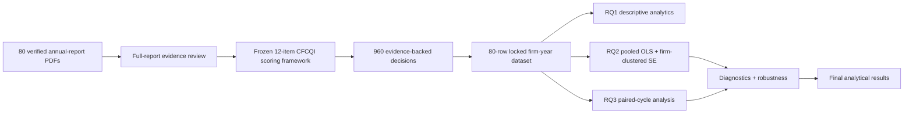
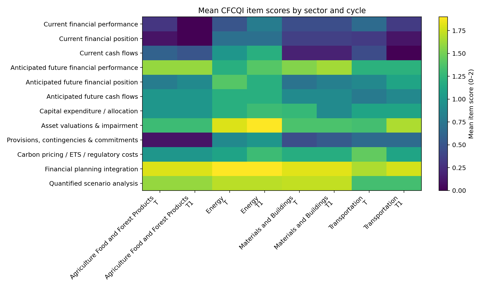

# CFCQI — Financially Connected Climate Disclosure in FTSE 350 Firms

> **Technical implementation, verified source corpus, analytical datasets, reproducible Python pipeline, statistical results and robustness evidence** for an MSc Business Analytics research project at Coventry University.


## Overview

This repository implements the **Climate Financial Connectivity and Quantification Index (CFCQI)**, a structured Business Analytics instrument for measuring how strongly climate-related corporate disclosure is connected to financially meaningful effects.

The technical workflow begins with **80 verified annual reports from 40 climate-sensitive FTSE 350 firms**, applies a frozen 12-item scoring framework, produces **960 evidence-backed item decisions**, builds a locked 80-row firm-year dataset, and runs descriptive analysis, reliability assessment, pooled regression, diagnostics, robustness checks and paired-cycle analysis.

The repository is deliberately limited to the **technical research layer**. It contains no Word submission files or assessment documents.

## Research workflow



The methodological sequence is:

**Pragmatism → Deductive approach → Mono-method quantitative → Quantitative content analysis → Two-period repeated firm-year design → Statistical analysis**

This is **not thematic analysis**. Documentary evidence is evaluated against predefined criteria and converted into numeric item scores.

## Research questions

### RQ1 — Disclosure level and pattern
What is the level and pattern of quantified and financially connected climate disclosure across the sample and two reporting cycles?

### RQ2 — Organisational determinants
Which organisational characteristics are associated with higher CFCQI scores?

### RQ3 — Reporting-cycle change
Do CFCQI scores change systematically between the prior and latest reporting cycles, and which disclosure dimensions show the largest remaining gaps?

## Hypotheses

| Test | Null hypothesis | Alternative hypothesis |
|---|---|---|
| Firm size | H01: no statistically significant association with CFCQI | H11: firm size is positively associated with CFCQI |
| External assurance | H02: no statistically significant association with CFCQI | H12: qualifying external assurance is associated with higher CFCQI |
| Board oversight | H03: no statistically significant association with CFCQI | H13: qualifying board-level oversight is associated with higher CFCQI |

## Sample and source corpus

The frozen sample contains **40 climate-sensitive FTSE 350 firms**, each contributing two consecutive reporting cycles.

| Group | Firms | Reports |
|---|---:|---:|
| Energy | 10 | 20 |
| Transportation | 9 | 18 |
| Materials & Buildings | 11 | 22 |
| Agriculture, Food & Forest Products | 10 | 20 |
| **Total** | **40** | **80** |

The repository contains the **verified source manifest, report index, SHA-256 hashes and corpus verification records**. The large issuer-owned PDF files are not stored in this GitHub repository; the technical implementation works from the locked evidence and analytical datasets. The verified source-corpus audit is:

| Check | Result |
|---|---:|
| Expected reports | 80 |
| PDFs present | 80 |
| Missing reports | 0 |
| SHA-256 mismatches | 0 |
| Unique verified reports | 80 |
| Status | **PASS** |

Each report is linked to the master manifest, source metadata, page count, file size and SHA-256 digest.

## CFCQI scoring framework

CFCQI contains 12 dimensions of financially connected climate disclosure.

| Item | Dimension |
|---:|---|
| I1 | Current financial performance |
| I2 | Current financial position |
| I3 | Current cash flows |
| I4 | Anticipated financial performance |
| I5 | Anticipated financial position |
| I6 | Anticipated cash flows |
| I7 | Climate-linked capital expenditure / resource allocation |
| I8 | Asset valuation, impairment and accounting estimates |
| I9 | Provisions, contingencies and commitments |
| I10 | Carbon pricing / regulatory financial effects |
| I11 | Financial planning, budgeting and capital allocation integration |
| I12 | Quantified scenario analysis with financial consequences |

### Item scoring

- **0** — no qualifying financial connection after full-report review
- **1** — explicit qualitative/specific but unquantified financial connection
- **2** — quantified effect or strong specific financial-statement/planning connection

The standardised index is:

```text
CFCQI = (sum of I1…I12 / 24) × 100
```

All items are equally weighted to keep the index transparent, reproducible and free from post-hoc weighting based on observed results.

CFCQI measures **disclosure depth**. It is not a regulatory-compliance score, climate-performance score or transition-quality rating.

## Evidence traceability

Every scoring decision is traceable through the following chain:

```text
Report_ID
  ↓
Annual-report PDF + SHA-256
  ↓
Evidence note + page reference
  ↓
I1…I12 item scores
  ↓
Raw CFCQI / standardised CFCQI
  ↓
Firm-year analytical row
  ↓
Statistical result
```

The repository contains:

- `80` firm-cycle evidence notes in `evidence/`
- `960` consolidated item decisions in `data/audit/CFCQI_EVIDENCE_AUDIT.csv`
- source validation and change-control logs in `data/audit/`

## Analytical variables

### Dependent variable

**CFCQI (0–100)** — standardised disclosure-depth score.

### Main explanatory variables

- **Firm size** — natural logarithm of total assets after consistent currency treatment
- **External sustainability assurance** — binary indicator for qualifying independent assurance
- **Board-level sustainability/climate oversight** — binary indicator for explicit board-level mandate

### Controls

- leverage
- Return on Assets (ROA)
- sector group
- reporting cycle

Full operational definitions are in `docs/06_DATA_DICTIONARY.md`.

## Analysis

### RQ1 — Descriptive analytics

The pipeline produces:

- overall mean, median, standard deviation and range
- cycle-level comparison
- sector-level comparison
- complete 12-item score distributions
- percentages scoring 0/1/2
- item heatmaps and comparative plots

### RQ2 — Organisational determinants

Primary specification:

```text
CFCQI_it =
β0
+ β1 FirmSize_it
+ β2 ExternalAssurance_it
+ β3 BoardOversight_it
+ β4 Leverage_it
+ β5 ROA_it
+ Sector_i
+ Cycle_t
+ ε_it
```

The primary model uses **pooled Ordinary Least Squares (OLS)** with **firm-clustered robust standard errors**.

Diagnostics include:

- Variance Inflation Factors (VIF)
- residual checks
- Breusch–Pagan heteroskedasticity test
- influence/leverage diagnostics
- Cook's distance

Robustness analysis includes:

- Mobico irregular-period exclusion
- Tesco 53-week sensitivity
- combined Mobico/Tesco exclusion
- Drax/F009 governance-classification sensitivity
- latest-cycle-only HC3 specification
- influential-observation sensitivity

### RQ3 — Paired reporting-cycle analysis

Change is defined as:

```text
ΔCFCQI = Latest cycle (T) − Prior cycle (T1)
```

Primary test:

- Wilcoxon signed-rank test

Complementary checks:

- paired t-test
- exact sign test
- item-level improvement / unchanged / deterioration analysis
- reporting-period exclusion sensitivity

## Reliability and validity

A 12-report repeat-scoring subset is retained with the exact scoring files and reliability script.

Headline result:

**Weighted Cohen's κ = 0.631**

Item-level agreement is also reported so the pooled coefficient is not interpreted as uniform reliability across every CFCQI dimension.

Validity is supported through:

- frozen construct definitions
- explicit scoring rules
- full-report review before assigning zero
- evidence-page traceability
- deterministic index formula
- locked analytical datasets
- diagnostic and robustness testing
- explicit interpretation boundaries

## Headline analytical results

### Overall CFCQI

**Mean CFCQI = 51.77 / 100**

The largest remaining weaknesses are direct connections to:

- current financial position
- current financial performance
- current cash flows

Financial-planning integration and quantified scenario analysis are stronger.

### RQ2 results

| Predictor | Result | Technical interpretation |
|---|---:|---|
| Firm size | β = 4.60, p = 0.018 | Positive in pooled model; weaker in latest-cycle-only HC3 |
| External assurance | p = 0.185 | Not independently statistically significant |
| Board oversight | β = 23.76, p < 0.001 | Strongest and most stable positive association |

Primary model **R² = 0.478**.

### RQ3 results

- 12 firms improved
- 20 firms were unchanged
- 8 firms declined
- Wilcoxon p = **0.896**

There is therefore no evidence of a systematic overall increase in CFCQI between the two observed cycles.

<p align="center"></p>

## Repository structure

```text
.
├── README.md
├── CITATION.cff
├── LICENSE-CODE
├── DATA_CORPUS_NOTICE.md
├── requirements.txt
├── run_all.sh
├── src/                         # shared analysis functions
├── scripts/                     # pipeline + verification scripts
├── tests/                       # integrity tests
├── data/
│   ├── input/                   # frozen scoring inputs
│   ├── processed/               # locked analytical datasets
│   ├── source_register/         # source metadata + hashes
│   └── audit/                   # validation + evidence audit
├── evidence/                    # 80 firm-cycle evidence notes
├── corpus/
│   ├── CORPUS_MANIFEST.csv
│   ├── CORPUS_VERIFICATION.json
├── results/
│   ├── tables/                  # statistical outputs
│   ├── figures/                 # analytical visualisations
│   └── packages/                # Excel / Power BI analysis packages
├── docs/                        # technical methodology and data docs
└── .github/workflows/           # reproducibility checks
```

## Quick start

### 1. Clone

```bash
git clone https://github.com/madireddyvasu/16814044-cfcqi-climate-disclosure.git
cd 16814044-cfcqi-climate-disclosure
```

### 2. Create environment

```bash
python3 -m venv .venv
source .venv/bin/activate
pip install -r requirements.txt
```

### 3. Optional local source-corpus verification

If you maintain a local copy of the 80 annual reports under `corpus/annual_reports/`, run:

```bash
python scripts/verify_corpus.py
```

The script validates the files against the frozen SHA-256 manifest.

### 4. Run tests

```bash
pytest -q
```

Expected:

```text
3 passed
```

### 5. Reproduce all analytical outputs

```bash
bash run_all.sh
```

The final reproducibility audit should finish with:

```text
all_pass: true
```

## Recommended review order

For a technical review, use this sequence:

1. `README.md`
2. `docs/04_CFCQI_CODEBOOK.md`
3. `corpus/CORPUS_MANIFEST.csv`
4. `evidence/`
5. `data/processed/`
6. `scripts/`
7. `results/tables/`
8. `results/figures/`
9. `data/audit/FINAL_REPRODUCIBILITY_AUDIT.json`

## Technical documentation

- `docs/01_PROJECT_OVERVIEW.md`
- `docs/02_RESEARCH_QUESTIONS_AND_HYPOTHESES.md`
- `docs/03_METHODOLOGY_RESEARCH_ONION.md`
- `docs/04_CFCQI_CODEBOOK.md`
- `docs/05_SAMPLE_SELECTION.md`
- `docs/06_DATA_DICTIONARY.md`
- `docs/07_RELIABILITY_VALIDITY.md`
- `docs/08_STATISTICAL_ANALYSIS.md`
- `docs/09_RESULTS_SUMMARY.md`
- `docs/10_ROBUSTNESS_AND_SENSITIVITY.md`
- `docs/11_REPRODUCIBILITY.md`
- `docs/12_DATA_LINEAGE.md`
- `docs/13_PROJECT_GOVERNANCE.md`

## Interpretation boundaries

- CFCQI measures disclosure depth, not regulatory compliance.
- Regression results are observational associations and do not establish causality.
- The sample represents large climate-sensitive FTSE 350 firms rather than the full UK corporate population.
- The design contains two reporting cycles only.
- Binary assurance and governance variables simplify richer organisational structures.
- Some CFCQI items have weaker repeat-scoring agreement than the pooled reliability coefficient.

## Data and rights

The Python code is licensed under `LICENSE-CODE`.

The company annual reports remain copyright of their respective issuers and are included only to support source verification and reproducibility. They are not relicensed by this repository. See `DATA_CORPUS_NOTICE.md`.

## Final technical status

- **40 firms**
- **80 verified source records**
- **80/80 report identities and hashes verified in the frozen corpus audit**
- **960 item-level CFCQI decisions**
- **80-row locked analytical dataset**
- **RQ1 / RQ2 / RQ3 pipeline complete**
- **diagnostics complete**
- **robustness suite complete**
- **reproducibility audit: PASS**

## Author

**Vasu Deva Rao Madireddy**  
Student ID: **16814044**  
MSc Business Analytics  
Coventry University
