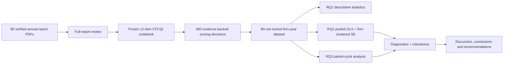

# CFCQI — Financially Connected Climate Disclosure in FTSE 350 Firms

> **MSc Business Analytics research and reproducibility repository** for  
> **_Quantified and Financially Connected Climate Disclosure in Climate-Sensitive FTSE 350 Firms: Determinants and Reporting Gaps Ahead of UK SRS S2_**


---

## 1. Project overview

Climate reporting can be extensive without being financially connected. Many annual reports describe climate strategy, transition plans, scenarios and governance, yet provide limited information about how climate-related matters affect current or anticipated financial position, financial performance, cash flows, asset values, provisions, capital allocation or financial planning.

This dissertation addresses that Business Analytics problem by developing the **Climate Financial Connectivity and Quantification Index (CFCQI)** and applying it to a verified two-period panel of climate-sensitive **Financial Times Stock Exchange 350 Index (FTSE 350)** firms.

The repository contains the complete research chain:

**annual-report PDF → verified source register → evidence note → 12 CFCQI scores → firm-year dataset → descriptive analysis → regression → diagnostics/robustness → paired-cycle analysis → dissertation findings and recommendations**

The repository is intended to make the dissertation **transparent, auditable and reproducible** rather than presenting only the final written paper.

---

## 2. Research problem and contribution

The central problem is not whether firms disclose climate information, but **whether that information is connected to financially meaningful consequences and quantified sufficiently to support decision-making**.

The project contributes in three ways:

1. **Measurement contribution** — a transparent 12-item CFCQI instrument converts annual-report evidence into a standardised 0–100 disclosure-depth score.
2. **Explanatory contribution** — firm characteristics are tested as determinants of stronger financially connected disclosure.
3. **Temporal contribution** — two consecutive reporting cycles are compared within the same firms to test whether disclosure depth changed systematically.

CFCQI is a **research index**. It is not a legal-compliance score, environmental-performance score, transition-quality rating or measure of corporate climate effectiveness.

---

## 3. Research questions

### RQ1 — Level and pattern
**What is the level and pattern of quantified and financially connected climate disclosure among the sample across two reporting cycles?**

### RQ2 — Organisational determinants
**Which organisational characteristics are associated with higher CFCQI scores?**

### RQ3 — Change over time
**Do CFCQI scores change systematically between the prior and latest reporting cycles, and which disclosure dimensions show the largest remaining gaps?**

---

## 4. Hypotheses

The regression component evaluates three paired null and alternative hypotheses.

| Test | Null hypothesis | Alternative hypothesis |
|---|---|---|
| Firm size | **H01:** Firm size has no statistically significant association with CFCQI. | **H11:** Firm size is positively associated with CFCQI. |
| External assurance | **H02:** External sustainability assurance has no statistically significant association with CFCQI. | **H12:** Firms obtaining external sustainability assurance have higher CFCQI scores. |
| Board oversight | **H03:** Board-level sustainability/climate oversight has no statistically significant association with CFCQI. | **H13:** Firms with qualifying board-level sustainability/climate oversight have higher CFCQI scores. |

---

## 5. Research design

The final supervisor-aligned methodology follows the **Research Onion**:

**Pragmatism → Deductive approach → Mono-method quantitative → Quantitative content analysis → Two-period repeated firm-year design → Structured data collection/scoring → Statistical analysis**



### Why this is quantitative content analysis rather than thematic analysis

The annual-report text is documentary evidence, but the analysis does **not** generate emergent themes. Each report is evaluated against a **predefined and frozen quantitative scoring instrument**. The evidence is converted into numerical item scores of 0, 1 or 2 and then into a standardised index. This makes the documentary review a structured **deductive quantitative content-analysis procedure**.

See [`docs/03_METHODOLOGY_RESEARCH_ONION.md`](docs/03_METHODOLOGY_RESEARCH_ONION.md).

---

## 6. Sample and verified source corpus

### Final sample

The frozen sample contains **40 climate-sensitive FTSE 350 firms**, grouped as follows:

| TCFD-aligned group | Firms | Reports |
|---|---:|---:|
| Energy | 10 | 20 |
| Transportation | 9 | 18 |
| Materials & Buildings | 11 | 22 |
| Agriculture, Food & Forest Products | 10 | 20 |
| **Total** | **40** | **80** |

Each company contributes **two consecutive reporting cycles**, producing **80 firm-year observations**.

### Complete PDF corpus included

The repository contains the **actual 80 annual-report PDFs** under:

```text
corpus/annual_reports/
```

The files are organised by sector and company and follow the exact relative paths in [`corpus/CORPUS_MANIFEST.csv`](corpus/CORPUS_MANIFEST.csv).

The final corpus verification produced:

| Audit | Result |
|---|---:|
| Manifest records | 80 |
| PDFs present | 80 |
| Missing reports | 0 |
| SHA-256 mismatches | 0 |
| Unique verified reports | 80 |
| Corpus verification | **PASS** |

The 80 files total approximately **1.00 GB**. Because of their size they should be tracked with **Git Large File Storage (Git LFS)**.

Run:

```bash
python scripts/verify_corpus.py
```

The expected result is an 80/80 pass. The machine-readable audit is stored in [`corpus/CORPUS_VERIFICATION.json`](corpus/CORPUS_VERIFICATION.json).

### Source traceability

For every annual report the source register retains:

- Report ID;
- company and sector;
- reporting cycle;
- exact report title;
- financial-year end;
- reporting-period start/end;
- reporting-period length;
- local PDF path;
- page count;
- file size;
- SHA-256 digest;
- verification/inclusion status;
- documented reporting-period or boundary issues.

This allows any CFCQI score to be traced back to the exact source document used in the dissertation.

---

## 7. CFCQI scoring framework

CFCQI contains **12 dimensions** of financially connected climate disclosure.

| Item | Dimension |
|---:|---|
| I1 | Current financial performance |
| I2 | Current financial position |
| I3 | Current cash flows |
| I4 | Anticipated financial performance |
| I5 | Anticipated financial position |
| I6 | Anticipated cash flows |
| I7 | Climate-linked capital expenditure / resource allocation |
| I8 | Asset valuation, impairment and accounting estimates |
| I9 | Provisions, contingencies and commitments |
| I10 | Carbon pricing / regulatory financial effects |
| I11 | Financial planning, budgeting and capital allocation integration |
| I12 | Quantified scenario analysis with financial consequences |

### Scoring scale

- **0** — no qualifying financial connection after full-report review;
- **1** — explicit qualitative or specific but unquantified financial connection;
- **2** — quantified financial effect or strong specific financial-statement/planning connection.

The raw score ranges from 0 to 24 and is standardised as:

```text
CFCQI = (sum of I1…I12 / 24) × 100
```

All 12 items are equally weighted. Equal weighting keeps the index transparent and avoids introducing post-hoc researcher discretion where no validated regulatory or empirical weighting structure exists.

The full frozen codebook is available in [`docs/04_CFCQI_CODEBOOK.md`](docs/04_CFCQI_CODEBOOK.md).

---

## 8. Evidence architecture

The project contains **80 firm-cycle evidence notes** in [`evidence/`](evidence/). Together they document all **960 CFCQI item decisions**.

A reviewer can follow this chain:

```text
Report_ID
  ↓
Annual-report PDF + SHA-256 digest
  ↓
Evidence note + page reference
  ↓
I1…I12 scores
  ↓
Raw CFCQI / standardised CFCQI
  ↓
Firm-year analytical row
  ↓
Statistical output
  ↓
Dissertation interpretation
```

The consolidated evidence audit is stored in:

[`data/audit/CFCQI_EVIDENCE_AUDIT.csv`](data/audit/CFCQI_EVIDENCE_AUDIT.csv)

See also [`docs/12_DATA_LINEAGE.md`](docs/12_DATA_LINEAGE.md).

---

## 9. Analytical variables

### Dependent variable

**CFCQI (0–100)** — the standardised disclosure-depth index.

### Main predictors

**Firm size**  
Natural logarithm of total assets after consistent currency treatment.

**External sustainability assurance**  
Binary indicator equal to 1 when qualifying sustainability/climate information receives independent external assurance and 0 otherwise. The normal statutory financial audit alone does not qualify.

**Board-level sustainability/climate oversight**  
Binary indicator equal to 1 when a board-level committee has an explicit sustainability/climate mandate and 0 otherwise.

### Controls

- leverage;
- Return on Assets (ROA);
- climate-sensitive sector group;
- reporting cycle.

Definitions, calculation rules and source fields are documented in [`docs/06_DATA_DICTIONARY.md`](docs/06_DATA_DICTIONARY.md).

---

## 10. Statistical analysis

### RQ1 — Descriptive analytics

The descriptive layer reports:

- mean, median, standard deviation, minimum and maximum CFCQI;
- cycle comparison;
- sector comparison;
- item-level means;
- percentage scoring 0, 1 and 2 for each item;
- heatmaps and distribution plots.

### RQ2 — Organisational determinants

Primary model:

```text
CFCQI_it =
β0
+ β1 FirmSize_it
+ β2 ExternalAssurance_it
+ β3 BoardOversight_it
+ β4 Leverage_it
+ β5 ROA_it
+ Sector_i
+ Cycle_t
+ ε_it
```

The primary specification uses **pooled Ordinary Least Squares (OLS)** with **firm-clustered robust standard errors**, because each company contributes two observations.

Diagnostics include:

- Variance Inflation Factors (VIF);
- residual inspection;
- Breusch–Pagan heteroskedasticity testing;
- studentised residuals;
- leverage and Cook's distance;
- influential-observation assessment.

Robustness analyses include:

- Mobico reporting-period exclusion;
- Tesco 53-week-period sensitivity;
- combined Mobico + Tesco exclusion;
- Drax/F009 board-oversight classification sensitivity;
- latest-cycle-only cross-sectional model using HC3 robust standard errors;
- influential-observation sensitivity.

### RQ3 — Within-firm reporting-cycle change

Change is defined unambiguously as:

```text
ΔCFCQI = Latest cycle (T) − Prior cycle (T1)
```

The primary test is the **Wilcoxon signed-rank test** because the paired-difference distribution is not treated as normally distributed. Complementary checks include:

- paired t-test;
- exact sign test;
- Mobico/Tesco sensitivity;
- complete 12-item improvement/unchanged/deterioration analysis.

See [`docs/08_STATISTICAL_ANALYSIS.md`](docs/08_STATISTICAL_ANALYSIS.md) and [`docs/10_ROBUSTNESS_AND_SENSITIVITY.md`](docs/10_ROBUSTNESS_AND_SENSITIVITY.md).

---

## 11. Reliability and validity

A 12-report repeat-scoring subset supports the reliability assessment. The repository retains the scoring files and exact calculation script.

Headline aggregate result:

**Weighted Cohen's κ = 0.631**

Item-level agreement varies, and the dissertation reports that variation transparently rather than using the pooled statistic to imply uniform reliability across all items.

Validity is treated through:

- explicit construct definitions;
- a frozen codebook;
- complete-report review before assigning zero;
- page-level evidence traceability;
- deterministic score formulas;
- locked datasets;
- multiple robustness tests;
- clear separation between disclosure depth and regulatory compliance.

See [`docs/07_RELIABILITY_VALIDITY.md`](docs/07_RELIABILITY_VALIDITY.md).

---

## 12. Headline results

### Overall disclosure

**Mean CFCQI = 51.77 / 100**

The overall profile is moderate rather than uniformly strong.

The largest gaps are in direct current financial connectivity:

- current financial position;
- current financial performance;
- current cash flows.

Financial-planning integration and scenario analysis are substantially stronger.

### Organisational determinants

| Predictor | Primary result | Interpretation |
|---|---:|---|
| Firm size | β = 4.60, p = 0.018 | Positive in pooled model; weaker in latest-only HC3 model |
| External assurance | p = 0.185 | Not independently statistically significant |
| Board oversight | β = 23.76, p < 0.001 | Strongest and most stable positive association |

Primary model **R² = 0.478**.

### Reporting-cycle change

- 12 firms improved;
- 20 were unchanged;
- 8 declined;
- Wilcoxon p = **0.896**.

Therefore, there is no evidence of a systematic overall increase in CFCQI across the two observed cycles.

<p align="center"></p>

---

## 13. Repository structure

```text
.
├── README.md
├── CITATION.cff
├── LICENSE-CODE
├── DATA_CORPUS_NOTICE.md
├── requirements.txt
├── run_all.sh
├── src/                         # shared analysis functions
├── scripts/                     # reproducible pipeline + corpus verification
├── tests/                       # integrity tests
├── data/
│   ├── input/                   # frozen scoring inputs
│   ├── processed/               # locked analytical datasets
│   ├── source_register/         # source metadata + hashes
│   └── audit/                   # validation + evidence audit
├── evidence/                    # 80 firm-cycle evidence notes
├── corpus/
│   ├── CORPUS_MANIFEST.csv      # 80-record source manifest
│   ├── CORPUS_VERIFICATION.json # hash audit
│   └── annual_reports/          # actual 80 PDFs
├── results/
│   ├── tables/                  # RQ1/RQ2/RQ3 + diagnostics/robustness
│   └── figures/                 # dissertation-quality figures
├── docs/                        # methodology + codebook + lineage + governance
├── deliverables/
│   ├── dissertation/            # final dissertation
│   ├── technical/               # technical implementation outputs
│   └── project_record/          # audit/supporting records
└── .github/workflows/           # automated reproducibility check
```

---

## 14. How to navigate the repository

If you are reviewing the project for the first time, use this order:

1. **README.md** — understand the full research design and findings.
2. **docs/01_PROJECT_OVERVIEW.md** — research scope and objectives.
3. **docs/03_METHODOLOGY_RESEARCH_ONION.md** — methodological architecture.
4. **docs/04_CFCQI_CODEBOOK.md** — understand each scoring dimension.
5. **corpus/CORPUS_MANIFEST.csv** — inspect the 80 source reports.
6. **evidence/** — inspect report-level evidence and scoring rationale.
7. **data/processed/** — inspect the locked analytical datasets.
8. **scripts/** — reproduce the statistical implementation.
9. **results/** — inspect tables and figures.
10. **deliverables/dissertation/** — read the final academic interpretation.

---

## 15. Reproducing the analysis

### Clone with Git LFS

Because the repository includes approximately 1 GB of annual-report PDFs, install Git LFS first.

```bash
git lfs install
git clone https://github.com/madireddyvasu/16814044-cfcqi-climate-disclosure.git
cd 16814044-cfcqi-climate-disclosure
git lfs pull
```

### Create the Python environment

```bash
python3 -m venv .venv
source .venv/bin/activate
pip install -r requirements.txt
```

### Verify the corpus

```bash
python scripts/verify_corpus.py
```

Expected result:

```text
80 reports checked
0 missing
0 hash mismatches
PASS
```

### Run tests

```bash
pytest -q
```

### Re-run the analytical pipeline

```bash
bash run_all.sh
```

The final reproducibility audit should finish with:

```text
all_pass: true
```

See [`docs/11_REPRODUCIBILITY.md`](docs/11_REPRODUCIBILITY.md).

---

## 16. Documentation index

- [Project overview](docs/01_PROJECT_OVERVIEW.md)
- [Research questions and hypotheses](docs/02_RESEARCH_QUESTIONS_AND_HYPOTHESES.md)
- [Research Onion and methodology](docs/03_METHODOLOGY_RESEARCH_ONION.md)
- [CFCQI codebook](docs/04_CFCQI_CODEBOOK.md)
- [Sample selection](docs/05_SAMPLE_SELECTION.md)
- [Data dictionary](docs/06_DATA_DICTIONARY.md)
- [Reliability and validity](docs/07_RELIABILITY_VALIDITY.md)
- [Statistical analysis](docs/08_STATISTICAL_ANALYSIS.md)
- [Results summary](docs/09_RESULTS_SUMMARY.md)
- [Robustness and sensitivity](docs/10_ROBUSTNESS_AND_SENSITIVITY.md)
- [Reproducibility guide](docs/11_REPRODUCIBILITY.md)
- [Data lineage](docs/12_DATA_LINEAGE.md)
- [Project governance](docs/13_PROJECT_GOVERNANCE.md)

---

## 17. Dissertation and technical deliverables

The `deliverables/` directory connects the implementation with the submitted research record. It includes the final dissertation and technical project documentation used to explain and audit the empirical work.

The repository is therefore not intended to be a separate portfolio reconstruction; it is the **reproducibility record of the actual dissertation implementation**.

---

## 18. Interpretation boundaries and limitations

When interpreting this repository, note that:

- CFCQI measures **disclosure depth**, not climate performance or compliance;
- the regression is observational and does not establish causality;
- the sample focuses on large climate-sensitive FTSE 350 firms;
- there are only two reporting cycles;
- binary assurance and governance measures simplify richer organisational structures;
- some CFCQI dimensions have weaker item-level repeat-scoring agreement than the pooled reliability coefficient;
- irregular reporting periods are handled through sensitivity analysis rather than ignored.

These constraints are treated as part of the research design and are discussed explicitly in the dissertation.

---

## 19. Ethics, provenance and responsible use

The study uses publicly available secondary corporate reports and does not involve human participants or collection of personal/special-category data.

The implementation emphasises:

- source provenance;
- report identity verification;
- SHA-256 hashing;
- transparent scoring rules;
- no fabricated observations;
- reproducible code;
- non-causal interpretation;
- explicit methodological limitations.

The annual reports remain copyright of their respective issuers and are retained here for academic verification/reproducibility. See [`DATA_CORPUS_NOTICE.md`](DATA_CORPUS_NOTICE.md).

---

## 20. Project status

**Final dissertation analysis frozen and reproducibility-audited.**

- 40 firms
- 80 verified annual reports
- 80/80 PDFs physically present
- 80/80 SHA-256 hashes verified
- 960 item decisions
- final analytical dataset locked
- RQ1/RQ2/RQ3 analyses reproduced
- diagnostics and robustness completed
- final audit passed

---

## Author

**Vasu Deva Rao Madireddy**  
**Student ID:** 16814044  
**Programme:** MSc Business Analytics  
**Institution:** Coventry University

