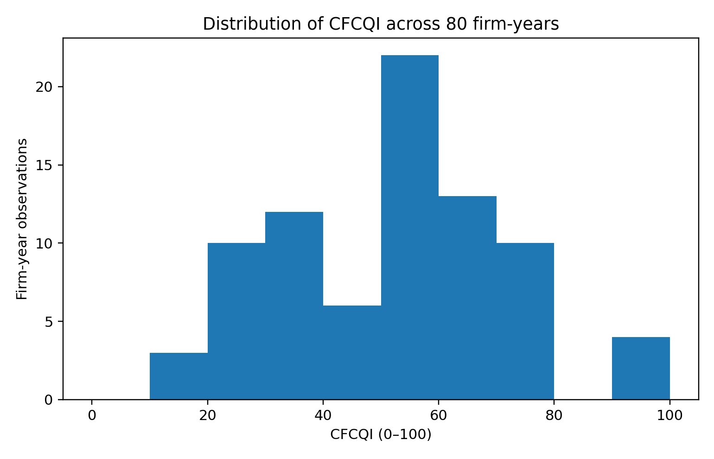
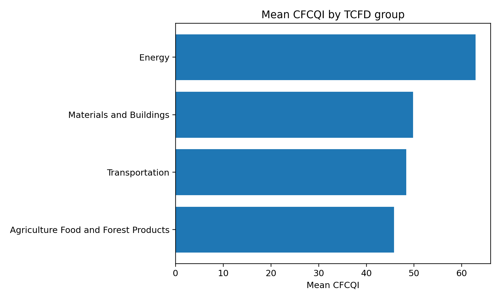
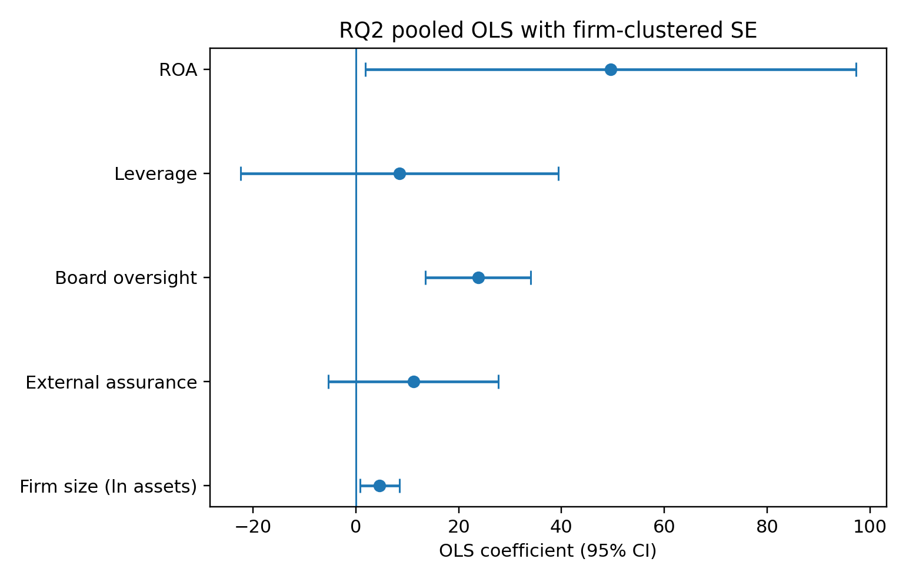
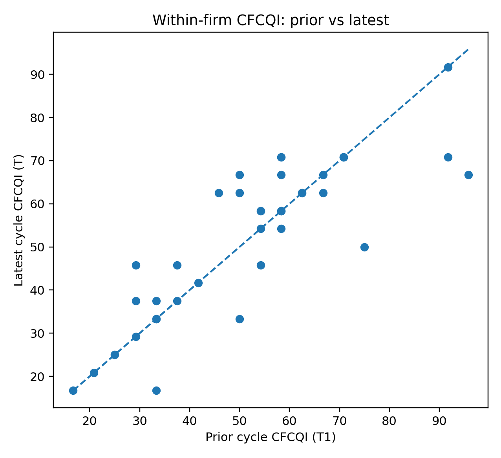
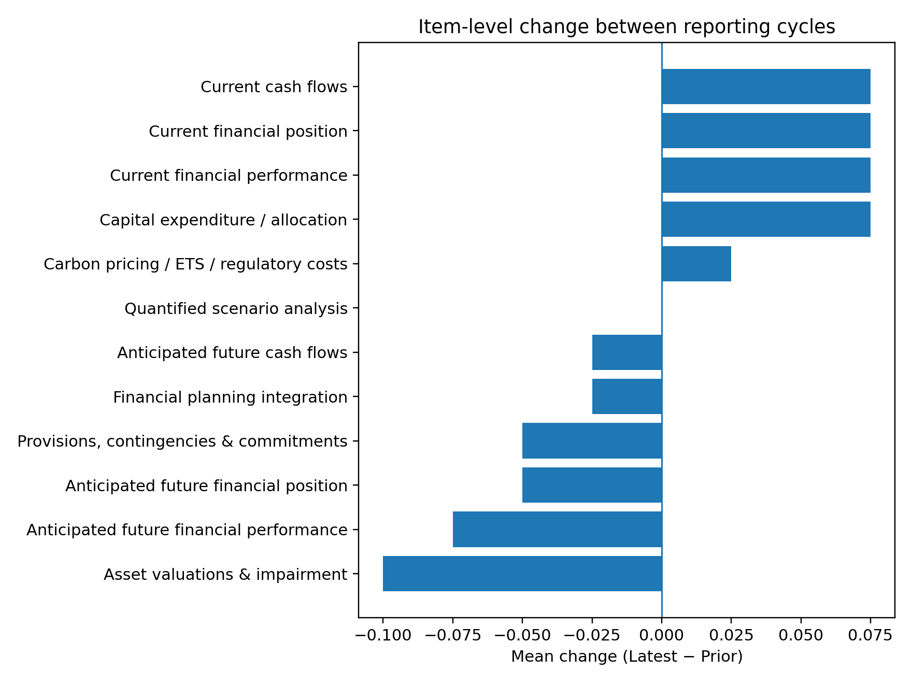

**TECHNICAL IMPLEMENTATION REPORT**

**Quantified and Financially Connected Climate Disclosure in Climate-Sensitive FTSE 350 Firms**

*Determinants and Reporting Gaps Ahead of UK SRS S2*

| **Student**         | Vasu Deva Rao Madireddy                          |
|---------------------|--------------------------------------------------|
| **Student ID**      | 16814044                                         |
| **Programme**       | MSc Business Analytics, Coventry University      |
| **Project route**   | Route 1 – Research Dissertation                  |
| **Technical stack** | Excel + Python; Power BI-ready data prepared     |
| **Corpus**          | 40 firms × 2 cycles = 80 verified annual reports |
| **Final dataset**   | 80 firm-year observations; 960 CFCQI decisions   |

| This document is the technical research record, not the dissertation. CFCQI is a researcher-developed disclosure index and must not be interpreted as a regulatory compliance percentage. RQ2 results are associational, not causal. |
|--------------------------------------------------------------------------------------------------------------------------------------------------------------------------------------------------------------------------------------|

# 1. Executive Summary

The technical implementation is complete and reproducible. The final corpus contains 80 verified consolidated group annual reports from 40 climate-sensitive FTSE 350 firms, with two consecutive reporting cycles per firm. Every annual report has a unique SHA-256 hash and all requested reports were publicly available by the report-eligibility cut-off of 31 August 2026. The final supervisor-reviewed sampling frame was frozen on 7 October 2026 using FTSE 350 membership and market-cap ranking; this timing distinction is retained explicitly in the audit trail rather than being concealed.

All 80 firm-years were coded using the frozen 12-item CFCQI instrument, producing 960 item-level decisions. The final mean CFCQI is 51.77 (SD 18.65). The pooled weighted Cohen’s kappa from the 15% repeat-scoring check is 0.631; this clears the pre-specified overall threshold, although item-level agreement is uneven and is treated as a methodological limitation.

The pooled RQ2 model explains 47.8% of CFCQI variation. Firm size is positively associated with CFCQI in the primary pooled model (p=0.018), external assurance is not statistically significant (p=0.185), and qualifying board-level sustainability/climate oversight has the largest positive association (approximately +23.8 CFCQI points, p\<0.001). The board-oversight result remains strong under all sensitivity checks. The size result remains positive but weakens to p=0.077 in the latest-cycle-only HC3 model, so it should be described as supported in the primary model but somewhat sample-size-sensitive.

For RQ3, the corrected change definition is Latest (T) minus Prior (T1). The mean change is effectively zero, the median change is zero, and the Wilcoxon signed-rank test is non-significant (p=0.896). Excluding Mobico, Tesco, or both does not alter that conclusion.

*Figure 1. Distribution of CFCQI across the 80 firm-year observations.*

# 2. Research Design and Analytical Architecture

The project uses secondary quantitative research using deductive quantitative content analysis of corporate annual reports. The unit of analysis is the firm-report-year. The workflow combines an auditable Excel evidence layer with Python-based validation and statistical analysis.

- 40 sampled non-financial FTSE 350 firms mapped to four TCFD climate-sensitive groups.

- Two consecutive annual reports per firm (T = latest; T1 = prior).

- Twelve CFCQI items scored 0, 1 or 2 under a frozen codebook.

- Firm-level explanatory variables: size, external sustainability assurance and board-level sustainability/climate oversight.

- Controls: leverage, ROA, TCFD group and reporting cycle.

- RQ1: descriptive level/pattern analysis; RQ2: pooled OLS with firm-clustered robust standard errors; RQ3: paired within-firm analysis.

# 3. Final Sample and Corpus

The supervisor-reviewed final sample differs from the earlier draft list. The implemented sample is the documented market-cap-ranked frozen sample, not the earlier illustrative company list. Transportation contained only nine defensibly mapped eligible firms, so one slot was reallocated to Materials and Buildings, producing a 10/9/11/10 distribution across the four groups.

| **TCFD group**                       | **Firms** | **Final sampled companies**                                                                                                                                                                         |
|--------------------------------------|-----------|-----------------------------------------------------------------------------------------------------------------------------------------------------------------------------------------------------|
| Agriculture Food and Forest Products | 10        | Diageo plc, Tesco plc, Coca-Cola HBC AG, Associated British Foods plc, Marks and Spencer Group plc, J Sainsbury plc, Mondi plc, Cranswick plc, Tate & Lyle plc, Ocado Group plc                     |
| Energy                               | 10        | Shell plc, BP plc, SSE plc, Centrica plc, DCC plc, Ithaca Energy plc, Harbour Energy plc, Drax Group plc, National Grid plc, Energean plc                                                           |
| Materials and Buildings              | 11        | Rio Tinto plc, Glencore plc, Anglo American plc, Antofagasta plc, Fresnillo plc, Endeavour Mining plc, Diploma plc, Smiths Group plc, Weir Group plc, Spirax-Sarco Engineering plc, IMI plc         |
| Transportation                       | 9         | International Consolidated Airlines Group SA, easyJet plc, Inchcape plc, Clarkson plc, Wizz Air Holdings plc, Zigup plc, FirstGroup plc, Aston Martin Lagonda Global Holdings plc, Mobico Group plc |

Source-corpus validation confirmed 80/80 verified reports, 80/80 unique SHA-256 hashes and zero unresolved duplicate files. Four invalid first-pass files were rejected/replaced during corpus construction: one wrong-year duplicate, two partial M&S files and one truncated Sainsbury’s report.

| Timing note: report eligibility was checked against 31 August 2026. The final sampling-frame / market-cap freeze used in the completed analysis is 7 October 2026. This distinction must be described explicitly in the methodology if the dissertation discusses a single “cut-off date”. |
|--------------------------------------------------------------------------------------------------------------------------------------------------------------------------------------------------------------------------------------------------------------------------------------------|

# 4. CFCQI Instrument and Coding Rules

The CFCQI contains 12 dimensions derived from climate-related financial-effects concepts. The scoring scale is consistent across items: 0 = no qualifying financial connection after full-report review; 1 = qualitative or specific but unquantified financial connection; 2 = quantified effect or strong specific financial-statement/planning connection. The codebook permits dual scoring where the same evidence legitimately supports different constructs.

| **Item** | **Construct**                     |
|----------|-----------------------------------|
| 1        | Current financial performance     |
| 2        | Current financial position        |
| 3        | Current cash flows                |
| 4        | Anticipated financial performance |
| 5        | Anticipated financial position    |
| 6        | Anticipated cash flows            |
| 7        | Capital expenditure / allocation  |
| 8        | Asset valuations & impairment     |
| 9        | Provisions / contingencies        |
| 10       | Carbon pricing / regulatory costs |
| 11       | Financial planning integration    |
| 12       | Quantified scenario analysis      |

CFCQI is calculated as the sum of the 12 item scores divided by the maximum raw score of 24 and multiplied by 100. The final evidence audit contains exactly 960 decisions. A final QA pass confirmed that every non-zero score has a page reference and that every evidence score matches the locked dataset.

# 5. Evidence Audit and Quality-Control Corrections

A final automated audit cross-checked the 80 evidence files against the locked dataset. It confirmed 960/960 item decisions. Three documentation issues were corrected without changing any underlying item score:

- Mobico F019-T1 item 6 had a valid qualitative future cash-flow rationale but the evidence table omitted the page reference; pages 73 and 183 were added.

- Weir Group F029 T and T1 contained stale summary lines reporting raw score 17 / CFCQI 70.8, while their 12 item scores correctly summed to 15 / 62.5. The summary lines were corrected; the locked dataset had already been correct.

- The original RQ3 script calculated T1−T while describing it as longitudinal change. It was corrected to Latest−Prior. The Wilcoxon p-value is unaffected, but item-level change signs are now correct.

# 6. Firm-Level Variables

| **Variable**       | **Operationalisation**                           | **Implementation note**                                                                                                           |
|--------------------|--------------------------------------------------|-----------------------------------------------------------------------------------------------------------------------------------|
| Size               | ln(total assets in £m)                           | Non-GBP reporters converted to GBP using documented ECB reference rates at balance-sheet dates.                                   |
| External assurance | 0/1                                              | 1 where independent assurance covers sustainability/environmental subject matter; statutory audit alone does not qualify.         |
| Board oversight    | 0/1                                              | 1 for dedicated/named board committee with explicit sustainability/climate/environment remit.                                     |
| Leverage           | Interest-bearing debt / total assets             | Bank overdrafts included; lease liabilities excluded where separately disclosed; documented Wizz Air exception where inseparable. |
| ROA                | Net income attributable to owners / total assets | Negative for loss-making firm-years.                                                                                              |

All 80 rows have complete model variables. The validation pass found no missing values, no duplicate firm-cycle records, no invalid 0–2 item values and no CFCQI formula mismatches.

# 7. Data Validation

| **Check**                      | **Observed** | **Expected** | **Status** |
|--------------------------------|--------------|--------------|------------|
| Rows in locked dataset         | 80           | 80           | PASS       |
| Unique firms                   | 40           | 40           | PASS       |
| T observations                 | 40           | 40           | PASS       |
| T1 observations                | 40           | 40           | PASS       |
| Duplicate firm-cycle rows      | 0            | 0            | PASS       |
| Missing CFCQI item values      | 0            | 0            | PASS       |
| Invalid CFCQI item values      | 0            | 0            | PASS       |
| Raw-score formula mismatches   | 0            | 0            | PASS       |
| CFCQI formula mismatches       | 0            | 0            | PASS       |
| Missing model variables        | 0            | 0            | PASS       |
| Evidence rows                  | 960          | 960          | PASS       |
| Non-zero evidence without page | 0            | 0            | PASS       |
| Unique report hashes           | 80           | 80           | PASS       |
| Included verified reports      | 80           | 80           | PASS       |

All automated final validation checks passed.

# 8. Reliability Assessment

Twelve reports (15% of the corpus) were repeat-scored using the documented stability-check workflow. Across 144 item comparisons, exact agreement was 66.7% and pooled weighted Cohen’s κ was 0.631. The pre-set overall κ threshold of 0.60 was therefore met.

However, reliability is not uniform across the instrument. Mean item-level κ was 0.306 and median item-level κ was 0.359; several individual items have weak or negative κ values. On the 12 re-coded reports, the correlation between original and re-coded total CFCQI was moderate (Pearson r=0.502), and the mean absolute total-score difference was 10.76 CFCQI points. These diagnostics should be acknowledged in the methodology/limitations rather than relying only on the pooled κ.

| **Item** | **Label**                                | **n** | **Exact agreement %** | **Weighted κ** |
|----------|------------------------------------------|-------|-----------------------|----------------|
| item1    | Current financial performance            | 12    | 50.0                  | -0.286         |
| item2    | Current financial position               | 12    | 75.0                  | -0.091         |
| item3    | Current cash flows                       | 12    | 91.7                  | 0.625          |
| item4    | Anticipated future financial performance | 12    | 75.0                  | 0.438          |
| item5    | Anticipated future financial position    | 12    | 41.7                  | 0.2            |
| item6    | Anticipated future cash flows            | 12    | 66.7                  | 0.351          |
| item7    | Capital expenditure / allocation         | 12    | 83.3                  | 0.556          |
| item8    | Asset valuations & impairment            | 12    | 75.0                  | 0.757          |
| item9    | Provisions, contingencies & commitments  | 12    | 58.3                  | 0.368          |
| item10   | Carbon pricing / ETS / regulatory costs  | 12    | 58.3                  | 0.5            |
| item11   | Financial planning integration           | 12    | 75.0                  | 0.25           |
| item12   | Quantified scenario analysis             | 12    | 50.0                  | 0.0            |
| ALL      | pooled across items                      | 144   | 66.7                  | 0.631          |

# 9. RQ1 – Level and Pattern of Disclosure

Across all 80 firm-years, mean CFCQI is 51.77, median 54.20, SD 18.65, range 16.7–95.8. Latest and prior cycle means are almost identical: 51.77 and 51.77, respectively.

| **TCFD group**                       | **n firm-years** | **Mean** | **Median** | **SD** |
|--------------------------------------|------------------|----------|------------|--------|
| Agriculture Food and Forest Products | 20               | 45.82    | 50.00      | 18.27  |
| Energy                               | 20               | 62.91    | 68.75      | 20.23  |
| Materials and Buildings              | 22               | 49.80    | 52.10      | 17.27  |
| Transportation                       | 18               | 48.38    | 52.10      | 14.60  |

Energy has the highest mean CFCQI (62.91), followed by Materials and Buildings (49.80), Transportation (48.38), and Agriculture/Food/Forest Products (45.82). These are descriptive comparisons and should not be interpreted as causal sector effects.

*Figure 2. Mean CFCQI by TCFD group.*

At item level, financial-planning integration, quantified scenario analysis, and asset valuation/impairment are the strongest dimensions. Current-period financial position, financial performance and cash-flow connectivity remain the weakest areas.

| **Item**                                 | **Mean (0–2)** | **% score 0** | **% score 1** | **% score 2** |
|------------------------------------------|----------------|---------------|---------------|---------------|
| Financial planning integration           | 1.81           | 2.5           | 13.8          | 83.8          |
| Quantified scenario analysis             | 1.60           | 2.5           | 35.0          | 62.5          |
| Asset valuations & impairment            | 1.50           | 3.8           | 42.5          | 53.8          |
| Anticipated future financial performance | 1.44           | 0.0           | 56.2          | 43.8          |
| Carbon pricing / ETS / regulatory costs  | 1.16           | 22.5          | 38.8          | 38.8          |
| Capital expenditure / allocation         | 1.11           | 20.0          | 48.8          | 31.2          |
| Anticipated future cash flows            | 0.99           | 28.7          | 43.8          | 27.5          |
| Anticipated future financial position    | 0.98           | 27.5          | 47.5          | 25.0          |
| Provisions, contingencies & commitments  | 0.55           | 57.5          | 30.0          | 12.5          |
| Current cash flows                       | 0.51           | 72.5          | 3.8           | 23.8          |
| Current financial performance            | 0.44           | 68.8          | 18.8          | 12.5          |
| Current financial position               | 0.34           | 77.5          | 11.2          | 11.2          |

*Figure 3. Mean item scores by sector and reporting cycle.*

# 10. RQ2 – Determinants of CFCQI

The primary RQ2 model is pooled OLS with firm-clustered robust standard errors. CFCQI is the dependent variable. Firm size, external assurance and board oversight are the focal predictors; leverage, ROA, TCFD group and reporting cycle are controls.

| **Predictor**         | **Coefficient** | **Clustered SE** | **p-value** | **95% CI**          |
|-----------------------|-----------------|------------------|-------------|---------------------|
| Firm size (ln assets) | 4.597           | 1.949            | 0.0183      | \[0.777, 8.417\]    |
| External assurance    | 11.171          | 8.433            | 0.1853      | \[-5.358, 27.700\]  |
| Board oversight       | 23.763          | 5.247            | 0.0000      | \[13.479, 34.047\]  |
| Leverage              | 8.468           | 15.773           | 0.5914      | \[-22.448, 39.383\] |
| ROA                   | 49.574          | 24.334           | 0.0416      | \[1.880, 97.269\]   |

The model R² is 0.478 (adjusted R² 0.410). H1 is supported in the primary pooled model: a one-unit increase in log assets is associated with approximately 4.60 additional CFCQI points (p=0.018). H2 is not supported: the assurance coefficient is positive but imprecise and non-significant (p=0.185). H3 is strongly supported: qualifying board oversight is associated with approximately 23.76 additional CFCQI points (p\<0.001), conditional on the other model terms.

ROA is also positive and statistically significant at the 5% level in the primary specification (p=0.042). Energy has a higher adjusted CFCQI than the Agriculture/Food/Forest reference group (p=0.040). These control/sector results should be treated as secondary to the pre-specified hypotheses.

*Figure 4. Primary RQ2 coefficients and 95% confidence intervals.*

# 11. RQ2 Diagnostics and Robustness

The maximum VIF is 1.93, so multicollinearity is not a material concern. Breusch–Pagan p=0.0438 indicates mild heteroscedasticity; the primary model already uses firm-clustered robust standard errors. Residual normality is not rejected (Shapiro p=0.2918). Six firm-years exceed Cook’s D \> 4/n in the original diagnostic pass.

| **Specification**      | **H1 p** | **H2 p** | **H3 p** |
|------------------------|----------|----------|----------|
| Base pooled            | 0.0183   | 0.1853   | 0.0000   |
| Exclude Mobico         | 0.0226   | 0.1907   | 0.0000   |
| Exclude Mobico + Tesco | 0.0209   | 0.1905   | 0.0000   |
| Exclude Tesco          | 0.0169   | 0.1846   | 0.0000   |
| F009 governance=0      | 0.0421   | 0.1725   | 0.0004   |
| Latest-only HC3        | 0.0765   | 0.7507   | 0.0016   |

H3 is the most stable result: board oversight remains statistically significant in every specification, including a conservative recode that sets the borderline F009 governance indicator from 1 to 0. H2 remains non-significant throughout. H1 remains significant in the pooled/exclusion/recode specifications, but in the latest-cycle-only HC3 model its p-value rises to approximately 0.077; therefore H1 should be described as supported in the primary design but less stable under the reduced 40-observation cross-section.

The original influence sensitivity that removes six high-Cook’s-D observations also preserves H1 and H3 and leaves H2 non-significant.

# 12. RQ3 – Within-Firm Change Across Reporting Cycles

Change is defined as Latest (T) minus Prior (T1). Across the 40 firms, mean change is -0.003 points and median change is 0.0. Twelve firms improve, 20 are unchanged, and eight deteriorate. The paired differences are non-normal, so the Wilcoxon signed-rank test is used as the primary test: W=101.5, p=0.8959. The paired t-test is also null (p=0.9988), and the exact sign test excluding ties is p=0.5034.

| **Specification**      | **n pairs** | **Mean change** | **Median change** | **Wilcoxon p** | **Paired t p** |
|------------------------|-------------|-----------------|-------------------|----------------|----------------|
| Full sample            | 40          | -0.003          | 0.00              | 0.8959         | 0.9988         |
| Exclude Mobico F019    | 39          | 0.426           | 0.00              | 0.6145         | 0.7930         |
| Exclude Tesco F032     | 39          | 0.213           | 0.00              | 0.7779         | 0.8983         |
| Exclude Mobico + Tesco | 38          | 0.658           | 0.00              | 0.4991         | 0.6899         |

The null conclusion remains after excluding Mobico (15-month latest period), Tesco (53-week latest period), or both.

*Figure 5. Prior vs latest CFCQI for each firm.*

Item-level movements are small and predominantly unchanged. Current financial performance, position and cash-flow items each improve by approximately 0.075 points on average; asset valuations/impairment declines by 0.10 points. These movements do not amount to a systematic overall shift in CFCQI.

*Figure 6. Mean item-level change (Latest − Prior).*

# 13. Special Cases and Sensitivity Flags

- Mobico F019 T covers 15 months to 31 March 2026. Figures were used as reported, not annualised; RQ2/RQ3 exclusion tests do not alter conclusions.

- Tesco F032 T is a 53-week reporting period. Exclusion from RQ2 and RQ3 does not alter headline conclusions.

- Mondi’s “Integrated report and financial statements” is the company’s complete annual statutory report and was retained.

- Smiths Group T uses FY2025 because FY2026 annual report was not published at the sampling freeze.

- Spirax Group is the renamed Spirax-Sarco Engineering group; the listed entity/ticker continuity was retained.

- M&S partial first-pass files were invalidated and fully re-coded from complete reports; the corrected rows materially increased M&S CFCQI but did not reverse headline study conclusions.

# 14. Reproducibility

The technical package contains source registers, the frozen codebook, coding/evidence files, final datasets, analysis scripts, results tables and figures. The final locked dataset can be reproduced from the master coding file using the supplied Python scripts. The principal execution sequence is:

- 01_validate_and_compute.py – validate 0–2 coding and compute CFCQI.

- 02_descriptives.py – produce RQ1 descriptive tables/figures.

- 03_reliability.py – compute exact agreement and weighted Cohen’s kappa.

- 04_regression_rq2.py – fit pooled OLS with firm-clustered robust SEs.

- 05_paired_rq3.py – corrected Latest−Prior paired analysis and item-level change outputs.

- 06_robustness.py – VIF, residual/influence diagnostics and core sensitivities.

- 07_final_audit_and_extended.py – final 960-row evidence audit, locked datasets, extended RQ2 sensitivity and reliability diagnostics.

# 15. Final Technical Conclusions

The technical implementation is complete, internally consistent and reproducible after final QA corrections. The strongest empirical finding is the positive association between qualifying board-level sustainability/climate oversight and CFCQI. Firm size is positively associated in the primary pooled model but is less stable when the sample is reduced to the latest cycle only. External assurance is not statistically associated with CFCQI in this sample. There is no evidence of a systematic within-firm increase or decrease in CFCQI across the two reporting cycles.

The principal methodological limitations to carry into the dissertation are: the distinction between the 31 August report-availability cut-off and 7 October sampling-frame freeze; uneven item-level coding reliability despite acceptable pooled κ; the small two-cycle panel; non-random sample construction based on climate sensitivity and market capitalisation; and residual judgement in several borderline content-analysis decisions.

# 16. Output Register

| **Output**                                | **Purpose**                                                                                                                        |
|-------------------------------------------|------------------------------------------------------------------------------------------------------------------------------------|
| VASU_FINAL_TECHNICAL_RESULTS.xlsx         | Consolidated professional Excel workbook containing sample, source register, codebook, evidence, data, validation and all results. |
| VASU_POWERBI_DATA.xlsx                    | Power BI-ready firm-year and item-long tables.                                                                                     |
| VASU_ANALYSIS_DATASET_LOCKED.csv          | Locked 80-row statistical dataset.                                                                                                 |
| CFCQI_EVIDENCE_AUDIT.csv                  | 960-row item-level evidence audit.                                                                                                 |
| CFCQI_FINAL_80.csv                        | Final scored 80-row CFCQI dataset.                                                                                                 |
| FIRM_VARIABLES_FINAL_80.csv               | Final firm-variable dataset.                                                                                                       |
| RQ2_EXTENDED_ROBUSTNESS.csv               | Expanded robustness specifications.                                                                                                |
| RQ3_SENSITIVITY.csv                       | Corrected paired-cycle sensitivity results.                                                                                        |
| RQ3_ITEM_CHANGES.csv                      | Corrected item-level Latest−Prior changes.                                                                                         |
| Vasu_Technical_Implementation_Report.docx | This technical research record.                                                                                                    |
